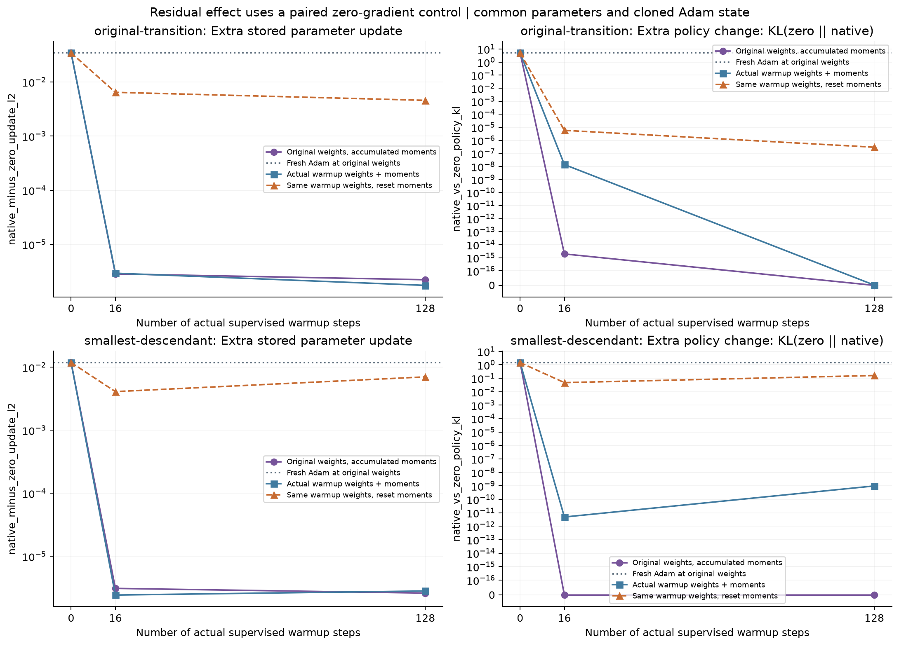

# Minimal examples and paired Adam controls

The original eight-prefix Qwen2.5-0.5B experiment changed one next-token argmax after native fp32 self-distillation and fresh Adam. The triggering prefix was `{"tool": "`, token IDs `[4913, 14172, 788, 330]`, with `Auto → m` (13253 → 76). Removing other rows and padding preserves this transition. The two-token prefix `[4913, 14172]` produces a different transition, 788 → 8226.

All 15 nonempty ordered subsequences of the four-token trigger were examined. No one-token candidate changed argmax. The complete reduction contains 38 probes, including batch and padding reductions. This establishes minimality within that finite search, not across arbitrary token sequences or architectures. Only the next token was compared; no tool was executed and no continuation was generated.

The model revision and optimizer configuration are fixed in the [README](README.md). Teacher and student begin each probe with identical weights and logits. Native fp32 soft CE first constructs rounded teacher probabilities; the logit-aware stable objective uses teacher logits directly. Their common ideal gradient is zero. Residuals can include both probability-target representation bias and backward arithmetic error.

## Existing state at fixed original weights

Adam state is accumulated by 128 hard-label updates on the same eight synthetic examples, with snapshots at steps 16 and 128. The stored first-moment norms are 11.9659 and 0.005658; the second-moment tensor norms are 3.9606 and 3.5407. Both moments are nonzero at all 494,032,768 parameter coordinates. This repeated tiny batch is a controlled state generator, not a representative long-training checkpoint.

Each probe restores original model weights, then installs the chosen state. This deliberately separates state from weight changes. Two branches clone that common start: one receives explicit zero gradients and the other the numerical residual. Both increment Adam step and decay moments normally.

| Four-token state | Zero-gradient branch update L2 | Extra residual update L2 | Extra KL | Zero / residual next token |
|---|---:|---:|---:|---|
| Fresh | 0 | 3.435e-2 | 5.0435 | `Auto` / `m` |
| 16 updates | 2.846e-2 | 2.858e-6 | 1.983e-15 | `Auto` / `Auto` |
| 128 updates | 2.849e-4 | 2.231e-6 | 0 | `Auto` / `Auto` |

The residual gradient norm stays 1.984e-4 in these rows. At state 128 it still changes about 19.52 million stored parameter coordinates relative to the zero branch, but the measured bf16 forward logits are identical. The two-token extra updates are 3.110e-6 and 2.621e-6 at states 16 and 128; both have zero extra KL and no extra argmax difference.

## Current warmup weights and state

At each actual warmup checkpoint, teacher logits are redefined from those same current weights. The four-token extra update L2 is 2.944e-6 at step 16 and 1.757e-6 at step 128; extra KL is 1.397e-8 and 1.894e-18. Neither pair differs in argmax. Resetting state at the same current weights produces larger residual updates, 6.431e-3 and 4.575e-3, without an argmax change. Weight sensitivity and state therefore both matter.

For the two-token input, the current-weight/current-state extra KL values are 4.876e-12 and 9.927e-10, again without extra argmax differences. All 14 comparisons are in [paired-summary.csv](minimization/results/paired-summary.csv).

The curves connect only measured histories 0, 16, and 128. The original counterexample is sensitive to fresh Adam state. These two accumulated states suppress its extra decision change; they do not establish that all numerical residuals are harmless during continued training.

Saved synthetic cases, all reduction probes, numeric summaries, and the two initial-fresh logit pairs are in `minimization/results/`. Run `analyze_minimum.py` as shown in the README to regenerate the tables and figures. Full optimizer states are regenerated by the CUDA experiment and are not included.
