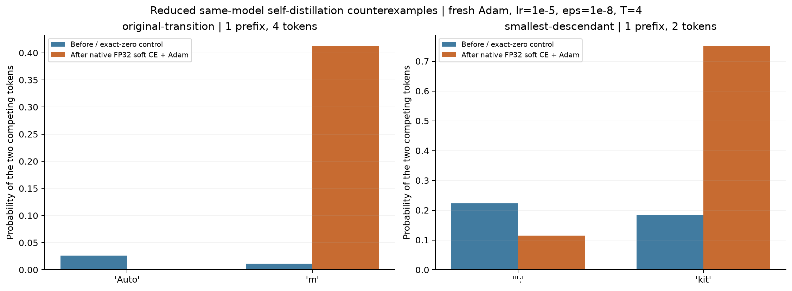

# Numerical Policy Lab

Small experiments on how floating-point loss residuals become optimizer updates and next-token decisions. The main example uses the public **Qwen2.5-0.5B** model: a self-distillation objective with identical teacher and student logits has an ideal zero gradient, yet native soft-target cross-entropy can leave a residual that changes the next-token argmax after one fresh Adam step.

This repository contributes an experimental setup, minimal inputs, paired optimizer controls, and saved measurements. The stable loss formulas are credited to [Jonathan T. Barron, Dan Gnanapragasam, and Michael Tschannen's softmaxfix project](https://jonbarron.info/softmaxfix/); they are not a new algorithm proposed here. These experiments do not rank optimizers by training quality or measure RL reward.

## The minimal examples

Model: [`Qwen/Qwen2.5-0.5B`](https://huggingface.co/Qwen/Qwen2.5-0.5B), revision `060db6499f32faf8b98477b0a26969ef7d8b9987`. The recorded runs use fp32 master parameters, bf16 autocast forward, eager attention, evaluation mode, and no KV cache. Self-distillation temperature is 4, without a T² multiplier. Adam uses lr=1e-5, epsilon=1e-8, betas=(0.9, 0.999), no weight decay, and no clipping.

| Input token IDs | Input length | Next-token argmax before → after fresh Adam | Residual gradient L2 | Actual update L2 | KL(before ∥ after) |
|---|---:|---|---:|---:|---:|
| `[4913, 14172, 788, 330]` | 4 | `Auto → m` (13253 → 76) | 1.984e-4 | 3.435e-2 | 5.0435 |
| `[4913, 14172]` | 2 | `": → kit` (788 → 8226) | 3.890e-5 | 1.180e-2 | 1.4667 |

The logit-aware stable control has zero gradient, update, and KL in both cases. Minimality is local: all 15 nonempty ordered subsequences of one four-token trigger were tested. Four tokens are needed to retain its original transition; two suffice for any argmax change in this search. Arbitrary tokens and other models were not searched.



## Why the paired controls matter

With existing momentum, an explicit zero gradient can still move parameters. Each history experiment therefore compares two branches from **the same weights and cloned optimizer state**: a native residual branch and an explicit zero-gradient branch. “Extra update” is their parameter difference; “extra KL” is KL(zero branch ∥ residual branch).

At the original weights, Adam states accumulated over 16 or 128 hard-label updates reduce the four-token residual's extra update from 3.435e-2 to 2.858e-6 / 2.231e-6, with no extra argmax difference. The two-token case also has no extra argmax difference at these histories. Independent ablations of `m`, `v`, and `step` identify historical second moments as the main amplitude suppressor; first moments and bias correction also affect decision boundaries.

For the tested **Muon + AdamW** grouping, the four-token case retains an extra argmax difference after 16 and 128 history updates. Parameter-group substitutions locate most of that policy effect in the Muon group. These are state-transplant diagnostics at fixed original weights, not optimizer quality comparisons.

## Read the experiments

| Document | Question |
|---|---|
| [Minimum and paired Adam controls](MINIMUM.md) | How small is the example, and what changes with optimizer history? |
| [Adam component ablations](ADAM_ABLATION.md) | What do `m`, `v`, and `step` each change? |
| [Muon + AdamW](MUON_ADAMW.md) | Which parameter group carries the extra policy effect? |
| [Real-model loss boundaries](REAL_MODEL.md) | How do CE arithmetic, casts, fused projection, and parameter writeback differ? |
| [CPU operator baseline](CPU_BASELINE.md) | When do operator errors survive a real optimizer writeback? |

## Run the CPU baseline

Python 3.12 is the recorded Python version. Install a suitable PyTorch build, then the small analysis dependencies:

```sh
python -m venv .venv
. .venv/bin/activate
python -m pip install -r requirements.txt
python lab.py --out runs/cpu --steps 1000 --seeds 0 1 2 --wandb-mode disabled
python analyze.py --results runs/cpu
python plot.py --results runs/cpu --out runs/cpu-figures
```

On Linux, an explicitly CPU-only PyTorch wheel can be installed with `python -m pip install torch==2.11.0 --index-url https://download.pytorch.org/whl/cpu` before the requirements. The standard package index supports the macOS setup.

This runs 96 synthetic arms on CPU. No model download or external model service is involved. `--threads 1` fixes the tiny-operator execution condition. Use a fresh output directory for each run. To inspect the saved results, replace `runs/cpu` with `results` in the two analysis commands; analysis writes derived summaries into that directory.

## Run the CUDA model experiments

The recorded environment used PyTorch 2.11.0+cu130, Transformers 5.8.1, Liger 0.8.5, and Triton 3.6.0. These commands require a compatible CUDA environment and download the pinned public model. Full-model backward and optimizer histories require substantial memory; the original real-model experiment reached about 35.32 GiB peak allocated memory, which is not a minimum requirement for every script.

```sh
python -m pip install torch==2.11.0 --index-url https://download.pytorch.org/whl/cu130
python -m pip install -r requirements-real-model.txt
python prepare_real_model.py --out runs/prepared.json --cache-dir runs/hf-cache
python real_model_step.py --prepared runs/prepared.json --out runs/real --wandb-mode disabled
python minimize_self_distillation.py --prepared runs/prepared.json --source-results runs/real --out runs/minimum --wandb-mode disabled
python ablate_adam_state.py --prepared runs/prepared.json --original-results runs/real --prior-results runs/minimum --out runs/ablation --state-cache-dir runs/adam-states --wandb-mode disabled
python compare_muon_adamw.py --prepared runs/prepared.json --original-results runs/real --prior-results runs/minimum --out runs/muon --state-cache-dir runs/muon-states --wandb-mode disabled
```

The final two scripts each construct their own optimizer history. Their state directories contain large locally generated checkpoints and are excluded from the repository. Package builds, hardware, and reduction implementations can change last bits and exact argmax boundaries. The bundled CUDA results are historical measurements; publication does not imply a fresh CUDA rerun.

Recompute saved analyses without a model download or GPU:

```sh
python real_model_analysis.py --results real-model/results --figures runs/real-figures
python analyze_minimum.py --results minimization/results --figures runs/minimum-figures
python analyze_adam_ablation.py --results adam-ablation/results --prior-results minimization/results
```

## Data and interpretation

The repository includes numeric CSVs, selected synthetic fixtures and logit/parameter samples needed by the analyzers, sanitized result summaries, and PNG/SVG figures. It excludes full model checkpoints, full optimizer checkpoints, tracking records, and operational launch records. Public manifests retain experiment settings and versions, not execution-machine metadata. Muon results are supplied as scalar summaries; its full branch logits are not bundled.

Parameter movement, distribution KL, and greedy-token changes are separate measurements. Model KL uses the actual bf16 forward logits and fp64 arithmetic, without distillation temperature. The CPU long curves instead use fp64 evaluation of master parameters before the loss-boundary cast. The stable loss consumes teacher logits; it is not a drop-in equivalent for arbitrary rounded probability targets, and higher-order derivatives are not guaranteed. No inference-backend mismatch, MTP, downstream generation quality, or RL reward was measured.

## License and upstream attribution

Original experiment code and documentation are released under the [MIT license](LICENSE). Stable loss formulas are credited to Barron, Gnanapragasam, and Tschannen through the [softmaxfix project](https://jonbarron.info/softmaxfix/). PyTorch, Transformers, and Liger remain separate upstream dependencies under their own licenses. The public Qwen2.5-0.5B checkpoint is supplied by Qwen under its [Apache 2.0 model license](licenses/Qwen2.5-0.5B-LICENSE). Full model weights are downloaded separately. The small saved parameter samples derived from that checkpoint retain its Apache 2.0 license; post-step samples include the experiment's optimizer modifications.
