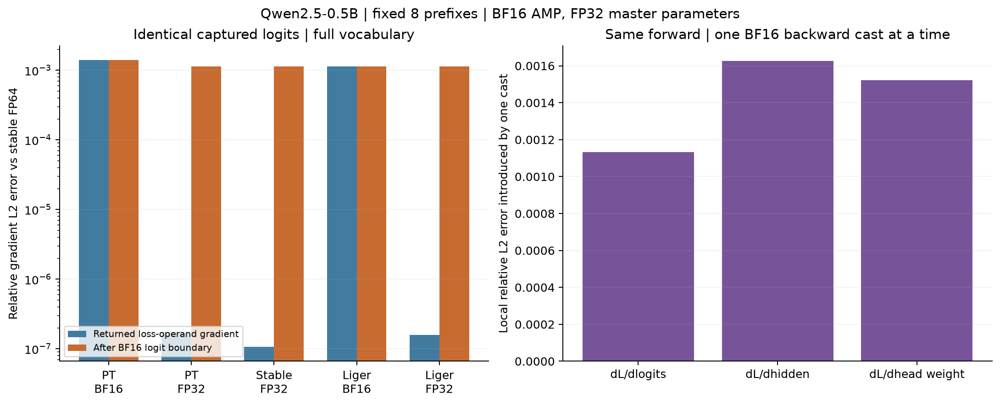
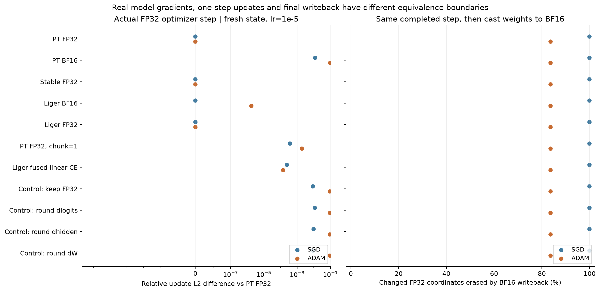
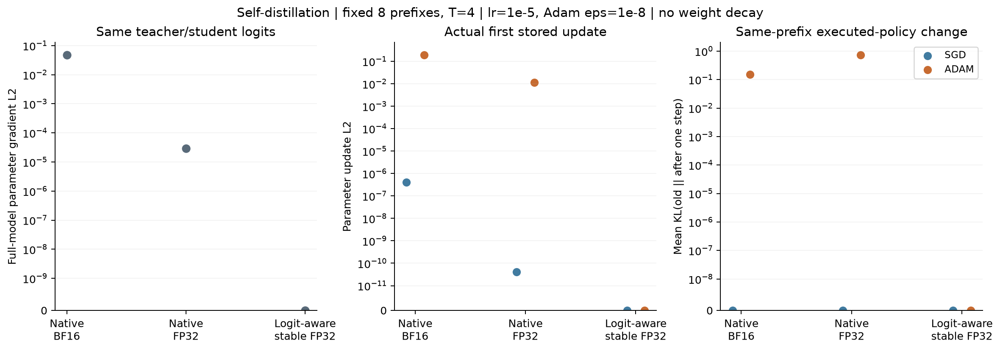

# Real-model loss, gradient, and writeback boundaries

The recorded Qwen2.5-0.5B experiment compares 14 gradient paths and 28 independent optimizer updates on one fixed batch of eight synthetic prefixes. CE arithmetic, gradient casts, and projection implementation can all change an actual optimizer update. The later [minimal examples](MINIMUM.md) isolate the native fp32 self-distillation argmax change.

The fixed revision is `060db6499f32faf8b98477b0a26969ef7d8b9987`, with 494,032,768 unique parameters and tied embedding/head weights. Parameters loaded from the bf16 checkpoint are converted to fp32 master parameters. Forward uses bf16 autocast, eager attention, evaluation mode, and no KV cache. Each independent branch restores the same initial weights, creates fresh SGD or Adam state, and uses lr=1e-5; Adam epsilon is 1e-8. Weight decay is zero.

The eight prefixes cover text, mathematics, code, tool-name text, tool-argument text, JSON, Chinese text, and numbers. Each supervises one next token. Tokenization can make a space or boundary-spanning token the actual target. [prefixes.json](real-model/results/prefixes.json) preserves inputs, target IDs, decoded text, and offsets. No tool execution or free generation occurs.

## Shared-logit CE comparisons

The isolated reference is a stable fp64 gradient computed from exactly the captured bf16 logits. Relative errors cover the full 8 × 151936 logit-gradient vector.

| CE path | Returned operand-gradient relative error | Error after bf16 logit boundary |
|---|---:|---:|
| PyTorch, bf16 operand | 1.391e-3 | 1.391e-3 |
| PyTorch, fp32 operand | 1.657e-7 | 1.132e-3 |
| Stable, fp32 operand | 1.064e-7 | 1.132e-3 |
| Liger, bf16 operand | 1.132e-3 | 1.132e-3 |
| Liger, fp32 operand | 1.594e-7 | 1.132e-3 |

PyTorch fp32, stable fp32, and Liger fp32 become coordinatewise identical after the bf16 logit boundary. Liger bf16 differs from PyTorch fp32 after cast at 40 coordinates even though their rounded aggregate error is the same. `pt_native` explicitly disables autocast around bf16 CE; it is a deliberately low-precision control, not the default PyTorch AMP CE behavior. A Liger bf16 operand does not establish that every internal reduction is bf16.

## Whole-model updates

The hard-label implementation baseline `pt_fp32` uses bf16 forward, a batched LM head, and explicit fp32 CE. It is a comparison path, not a high-precision whole-model truth.

| Path versus pt_fp32 | Model gradient relative difference | SGD update relative difference | Adam update relative difference |
|---|---:|---:|---:|
| PyTorch bf16 CE | 1.150e-2 | 1.169e-2 | 9.576e-2 |
| Stable fp32 CE | 0 | 0 | 0 |
| Liger bf16 CE | 1.263e-11 | 0 | 1.767e-6 |
| Liger fp32 CE | 0 | 0 | 0 |
| PyTorch fp32, one-token projection chunks | 3.635e-4 | 3.644e-4 | 1.888e-3 |
| Liger fused linear CE | 2.409e-4 | 2.430e-4 | 1.428e-4 |

Liger 0.8.5 fused linear CE uses `accum_dtype=torch.float32`. Its projection chunk size is one at this shape. The one-token PyTorch control reproduces that chunking change and has identical initial forward logits to the batched path, while backward still differs. Fused linear CE changes projection, reduction, and backward together. Its internal logits were not exported: the external captured logits cannot establish bitwise equality of the fused kernel's internal operands, or attribute its whole difference to CE alone.

Diagnostic head backward controls use the same fp32 matrix products with TF32 disabled and introduce a bf16 round trip at just one boundary. Rounding `dL/dlogits`, `dL/dhidden`, or `dL/dW_head` produces local relative errors of 1.132e-3, 1.626e-3, and 1.522e-3. On 1,024 sampled coordinates in four parameter blocks, the corresponding Adam results differ from `ctrl_keep` at 27, 35, and 3 coordinates. After bf16 writeback, only the hidden-gradient cast retains a sampled difference, at one coordinate. These samples are not whole-model pairwise update norms; `ctrl_keep` is a diagnostic implementation, not a demonstrated superior truth.

## Parameter writeback

For hard-label `pt_fp32`, SGD changes 347,182,882 master-parameter coordinates. After projecting the completed result to bf16, 350,166 coordinates still differ from initialization: 99.899% of changed coordinates are erased. Adam's corresponding count fraction is 83.594%. These are coordinate fractions, not energy fractions.

SGD mean policy KL is about 0.09928 with fp32 master writeback and 0.10236 after bf16 projection. Removing many small coordinate updates does not necessarily remove the policy effect. `bf16_writeback` means projecting the same completed update to bf16, then restoring it to an fp32 container for evaluation. It is not a second optimizer call or bf16 optimizer-state arithmetic. Fourteen paths × two optimizers give 28 actual updates and 56 writeback evaluations.

## Self-distillation

Teacher logits are fixed from identical model weights and inputs. Temperature is 4 without a T² multiplier. Results below use fp32 master writeback.

| Soft CE path | Model gradient L2 | SGD update L2 | Adam update L2 | Adam mean KL | Adam argmax changes |
|---|---:|---:|---:|---:|---:|
| Native bf16 | 4.706e-2 | 4.066e-7 | 1.884e-1 | 0.1531 | 2/8 |
| Native fp32 | 2.879e-5 | 4.030e-11 | 1.126e-2 | 0.7198 | 1/8 |
| Logit-aware stable fp32 | 0 | 0 | 0 | 0 | 0/8 |

Both native SGD branches have nonzero parameter movement but identical executed logits and zero KL. Fresh Adam produces a distribution and next-token difference. After bf16 parameter projection, native fp32 Adam still has update L2=3.815e-3, mean KL=0.6628, and 1/8 argmax changes. A smaller gradient norm need not imply a smaller policy change.

The stable loss follows [Barron's softmaxfix formulas](https://jonbarron.info/softmaxfix/) and consumes teacher logits. Native soft CE consumes rounded teacher probabilities, so the two share an objective only in exact arithmetic. This model experiment does not separately assign residuals to target representation bias and CE backward error. The stable implementation is a first-order custom backward, not an equivalent replacement for arbitrary stored probability targets.

Policy KL uses actual bf16 forward logits, fp64 arithmetic, and no distillation temperature. Centering the logit difference and using `expm1`, `log1p`, and a small-difference series reduces cancellation. Comparisons cover these same prefixes only.

## Saved evidence and reproduction

The README supplies the fresh CUDA and saved-analysis commands. The published environment versions are retained in the sanitized manifest. No fresh CUDA rerun is claimed for this release. Hardware and library changes can alter the last bits and concrete boundaries.

The selected files contain scalar metrics, full isolated logit-gradient arrays, captured logits/hidden values, and fixed diagnostic parameter samples. They do not contain full per-path model gradients or complete updated checkpoints. Whole-model comparison norms were computed during execution; recomputing those norms requires running the corresponding paths. The saved analyzer can regenerate CE tables, sampled-control comparisons, writeback summaries, and figures without a model download or GPU.
